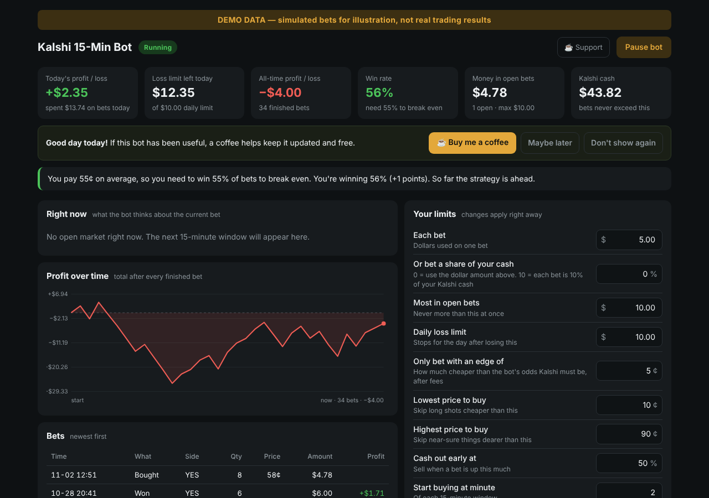

# Kalshi 15-Minute Crypto Bot

A small bot that trades Kalshi's 15-minute crypto markets ("Will BTC be up in the next 15 minutes?") from your own Windows laptop, with a live dashboard in your browser.

*Screenshot uses simulated demo data, not real trading results.*

> **Warning: real money.** This bot places real bets on your Kalshi account. You can lose money, and most people lose a little over time after fees. Nothing here is financial advice, and past results (yours or anyone's) don't predict future ones. Only use money you can afford to lose. The software is provided as-is (see [LICENSE](LICENSE)).

## How it decides

For every coin you tick (Bitcoin, Ethereum, Solana, XRP, BNB, Dogecoin, Hyperliquid, Zcash, NEAR and others Kalshi lists):

1. Gets the coin's **live price** (Coinbase, Kraken or OKX) and Kalshi's **target price** for the window.
2. Works out the **chance of YES** from the distance to the target, minutes left, and how jumpy the coin has been over the last hour.
3. Between minute 2 and 12, bets **YES or NO only when Kalshi's price is at least 5¢ cheaper than that chance**, after Kalshi's fee. Otherwise it shows **NO TRADE** with the reason.
4. Cashes out early when Kalshi offers more than the bet is worth, or at +50%.
5. Stays inside your limits: bet size, money in open bets, daily loss limit, and never more than your Kalshi cash. It also skips a bet if its odds and Kalshi's are wildly different (usually bad price data).

## Dashboard

Opens automatically at **http://localhost:8765** (only on your own computer):

- Today's and all-time profit/loss, win rate vs. break-even, cash, open bets
- "Right now" card for every coin: live price, target, the bot's odds, best deal, and what it will do and why
- Profit chart, every bet, results by day, activity log
- **Your limits**: change bet size (fixed $ or % of cash), limits, price range, edge, minutes, and coins. Changes apply immediately
- **Pause / Resume** button

## Setup (Windows, about 20 minutes)

1. **Install Python 3** from python.org. Tick **"Add python.exe to PATH"** on the first screen.
2. **Download this repo** (green **Code** button, then **Download ZIP**) and unzip it to `C:\kalshi-bot`.
3. **Create a Kalshi API key** on the Kalshi *website* (not docs.kalshi.com): kalshi.com → Profile settings → **API Keys** → **Create New API Key**. Pick **Ed25519** and leave the "add your own public key" box empty. Copy the **Key ID**. Kalshi downloads a **key file (.txt)**; move it into `C:\kalshi-bot`.
4. **Open `bot.py` in Notepad**, replace `PASTE-YOUR-KEY-ID-HERE` with your Key ID (keep the quotes), and save.
5. **Double-click `check.bat`.** It shows your balance and the bot's view of the current markets, and places no bets.
6. **Double-click `run.bat`** to start. Keep the black window open, and set Windows Sleep to **Never** while plugged in.

Kalshi keeps crypto money in a separate "pot"; the bot moves cash into it automatically when needed.

## Troubleshooting

| You see | Do this |
| --- | --- |
| `'python' is not recognized` | Reinstall Python with **Add python.exe to PATH** ticked |
| Key file not found | Put the key file Kalshi downloaded into the bot folder |
| HTTP 401 / key rejected | The Key ID and key file don't match. Create a new key |
| `insufficient shard balance` | Update to the latest version (it funds the crypto pot itself) |
| `too many requests` | Normal now and then; the bot slows down and retries |
| Lots of NO TRADE | Normal. Good deals are rare; that's the point |

## Your files stay private

Your key, settings, bet history and logs are in `.gitignore`. **Never share your key file or Key ID.** Anyone with them can trade your account.

## Support

If the bot is useful to you, you can [sponsor the project](https://github.com/sponsors/bounty-bunny) ☕. The dashboard has a small Support button and, rarely, a thank-you note (only after a week of use and on a day you're up; "Maybe later" hides it for 30 days, and "Don't show again" turns it off). To remove it, set `SUPPORT_URL = ""` in `bot.py`.

## License

MIT. Check Kalshi's [Developer Agreement](https://kalshi.com/developer-agreement) before using their API.
